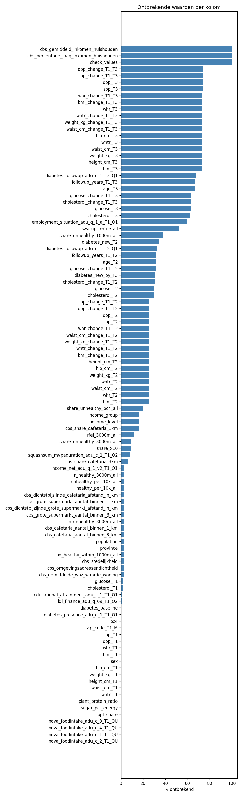
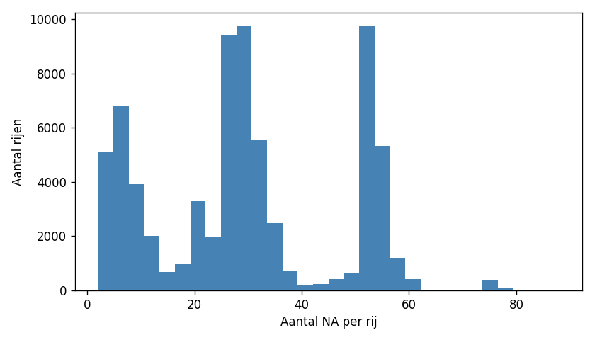
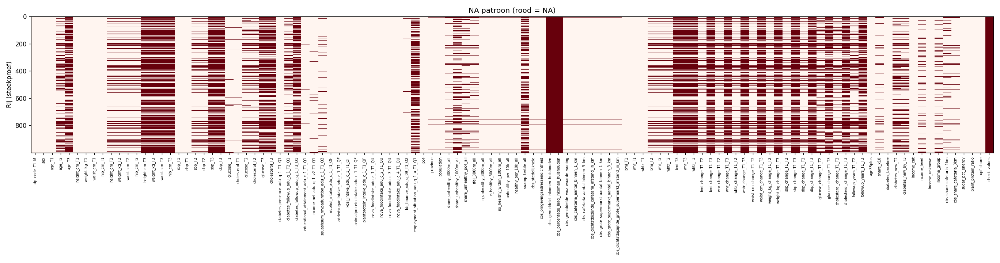
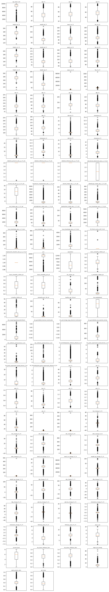

# Datakwaliteit merged.csv

## Overzicht

- Rijen: 71403
- Kolommen: 114
- Geheugen: 89.2 MB

### Eerste 5 rijen

| zip_code_T1_M | sex | age_T1 | age_T2 | age_T3 | height_cm_T1 | weight_kg_T1 | waist_cm_T1 | hip_cm_T1 | height_cm_T2 | weight_kg_T2 | waist_cm_T2 | hip_cm_T2 | height_cm_T3 | weight_kg_T3 | waist_cm_T3 | hip_cm_T3 | sbp_T1 | dbp_T1 | sbp_T2 | dbp_T2 | sbp_T3 | dbp_T3 | glucose_T1 | cholesterol_T1 | glucose_T2 | cholesterol_T2 | glucose_T3 | cholesterol_T3 | diabetes_presence_adu_q_1_T1_Q1 | diabetes_followup_adu_q_1_T2_Q1 | diabetes_followup_adu_q_1_T3_Q1 | educational_attainment_adu_c_1_T1_Q1 | income_net_adu_q_1_v2_T1_Q1 | squashsum_mvpaduration_adu_c_1_T1_Q2 | alcohol_intake_adu_c_1_T1_QF | addedsugar_intake_adu_c_1_T1_QF | kcal_intake_adu_c_1_T1_QF | animalprotein_intake_adu_c_1_T1_QF | plantprotein_intake_adu_c_1_T1_QF | nova_foodintake_adu_c_1_T1_QU | nova_foodintake_adu_c_2_T1_QU | nova_foodintake_adu_c_3_T1_QU | nova_foodintake_adu_c_4_T1_QU | ldi_finance_adu_q_09_T1_Q2 | employment_situation_adu_q_1_a_T1_Q1 | pc4 | province | population | share_unhealthy_3000m_all | share_unhealthy_1000m_all | share_unhealthy_pc4_all | rfei_3000m_all | n_unhealthy_3000m_all | n_healthy_3000m_all | no_healthy_within_1000m_all | unhealthy_per_10k_all | healthy_per_10k_all | swamp_tertile_all | cbs_stedelijkheid | cbs_omgevingsadressendichtheid | cbs_gemiddeld_inkomen_huishouden | cbs_percentage_laag_inkomen_huishouden | cbs_gemiddelde_woz_waarde_woning | cbs_cafetaria_aantal_binnen_1_km | cbs_cafetaria_aantal_binnen_3_km | cbs_dichtstbijzijnde_cafetaria_afstand_in_km | cbs_grote_supermarkt_aantal_binnen_1_km | cbs_grote_supermarkt_aantal_binnen_3_km | cbs_dichtstbijzijnde_grote_supermarkt_afstand_in_km | bmi_T1 | whr_T1 | whtr_T1 | bmi_T2 | whr_T2 | whtr_T2 | bmi_T3 | whr_T3 | whtr_T3 | bmi_change_T1_T2 | bmi_change_T1_T3 | whr_change_T1_T2 | whr_change_T1_T3 | whtr_change_T1_T2 | whtr_change_T1_T3 | waist_cm_change_T1_T2 | waist_cm_change_T1_T3 | weight_kg_change_T1_T2 | weight_kg_change_T1_T3 | sbp_change_T1_T2 | sbp_change_T1_T3 | dbp_change_T1_T2 | dbp_change_T1_T3 | glucose_change_T1_T2 | glucose_change_T1_T3 | cholesterol_change_T1_T2 | cholesterol_change_T1_T3 | followup_years_T1_T2 | followup_years_T1_T3 | age35plus | share_x10 | diabetes_baseline | diabetes_new_T2 | diabetes_new_by_T3 | income_cat | income_level | income_unknown | income_group | cbs_share_cafetaria_1km | cbs_share_cafetaria_3km | sugar_pct_energy | plant_protein_ratio | upf_share | check_values |
|---|---|---|---|---|---|---|---|---|---|---|---|---|---|---|---|---|---|---|---|---|---|---|---|---|---|---|---|---|---|---|---|---|---|---|---|---|---|---|---|---|---|---|---|---|---|---|---|---|---|---|---|---|---|---|---|---|---|---|---|---|---|---|---|---|---|---|---|---|---|---|---|---|---|---|---|---|---|---|---|---|---|---|---|---|---|---|---|---|---|---|---|---|---|---|---|---|---|---|---|---|---|---|---|---|---|---|---|---|---|---|---|---|---|
| 7912.0 | FEMALE | 46.0 | nan | nan | 181.0 | 113.0 | 99.0 | 119.0 | nan | nan | nan | nan | nan | nan | nan | nan | 125.0 | 66.0 | nan | nan | nan | nan | 5.3 | 5.7 | nan | nan | nan | nan | 2.0 | nan | nan | 2.0 | 12.0 | nan | 0.006 | 48.688 | 2468.321 | 42.294 | 42.016 | 823.2631 | 4.5627 | 19.1481 | 870.4659 | 1.0 | nan | 7912.0 | NL-DR | 645.0 | 0.5 | nan | nan | 1.0 | 1.0 | 1.0 | True | 0.0 | 0.0 | nan | 5.0 | 75.0 | nan | nan | 347.0 | 0.0 | 0.8 | 2.4 | 0.0 | 0.8 | 2.6 | 34.49223161686151 | 0.8319327731092437 | 0.5469613259668509 | nan | nan | nan | nan | nan | nan | nan | nan | nan | nan | nan | nan | nan | nan | nan | nan | nan | nan | nan | nan | nan | nan | nan | nan | nan | nan | True | 5.0 | False | nan | nan | 1500-2000 | 4.0 | False | 1500-2500 | nan | 0.5 | 7.890059680244183 | 0.4983513225002965 | 0.5068392499114088 | nan |
| 6541.0 | FEMALE | 31.8 | 34.4 | nan | 161.0 | 77.0 | 92.0 | 107.0 | 161.5 | 76.0 | 97.0 | 102.0 | nan | nan | nan | nan | 120.0 | 73.0 | 118.0 | 75.0 | nan | nan | 4.4 | 3.7 | 4.6 | 4.2 | nan | nan | 2.0 | 2.0 | nan | 2.0 | 11.0 | nan | 0.0 | 65.075 | 2115.756 | 61.771 | 28.28 | 1835.6458 | 4.4835 | 16.8399 | 1173.1167 | 1.0 | nan | 6541.0 | nan | nan | nan | nan | nan | nan | nan | nan | nan | nan | nan | nan | nan | nan | nan | nan | nan | nan | nan | nan | nan | nan | nan | 29.705644072373747 | 0.8598130841121495 | 0.5714285714285714 | 29.1385904206884 | 0.9509803921568628 | 0.6006191950464397 | nan | nan | nan | -0.5670536516853488 | nan | 0.0911673080447131 | nan | 0.0291906236178682 | nan | 5.0 | nan | -1.0 | nan | -2.0 | nan | 2.0 | nan | 0.1999999999999993 | nan | 0.5 | nan | 2.599999999999998 | nan | False | nan | False | False | False | 1000-1500 | 3.0 | False | <1500 | nan | nan | 12.302930961793328 | 0.3140442638060655 | 0.3871562519069179 | nan |
| 9635.0 | FEMALE | 38.0 | nan | nan | 185.0 | 75.0 | 85.0 | 106.0 | nan | nan | nan | nan | nan | nan | nan | nan | 100.0 | 59.0 | nan | nan | nan | nan | 5.2 | 4.0 | nan | nan | nan | nan | 2.0 | nan | nan | 2.0 | 14.0 | 30.0 | 2.512 | 105.202 | 2315.46 | 43.325 | 32.81 | 1922.3924 | 31.6737 | 41.4193 | 1305.5579 | 1.0 | nan | 9635.0 | NL-GR | 1825.0 | 0.5 | 0.5 | 0.5 | 1.0 | 1.0 | 1.0 | False | 5.47945205479452 | 5.47945205479452 | mid | 5.0 | 187.0 | nan | nan | 298.0 | 0.8 | 1.1 | 0.8 | 0.9 | 1.0 | 0.8 | 21.91380569758948 | 0.8018867924528302 | 0.4594594594594595 | nan | nan | nan | nan | nan | nan | nan | nan | nan | nan | nan | nan | nan | nan | nan | nan | nan | nan | nan | nan | nan | nan | nan | nan | nan | nan | True | 5.0 | False | nan | nan | 2500-3000 | 6.0 | False | 2500-3000 | 0.4705882352941176 | 0.5238095238095238 | 18.173840187263004 | 0.4309450318513167 | 0.3954985685889064 | nan |
| 8939.0 | FEMALE | 24.1 | nan | 33.2 | 186.0 | 77.0 | 66.0 | 96.0 | nan | nan | nan | nan | nan | nan | nan | nan | 131.0 | 66.0 | nan | nan | nan | nan | 4.9 | 4.3 | nan | nan | 5.2 | 4.6 | 2.0 | nan | 2.0 | 3.0 | 13.0 | 580.0 | 2.807 | 34.443 | 1404.884 | 30.256 | 23.992 | 1055.8562 | 0.9533 | 7.4366 | 587.8239 | 1.0 | 1.0 | 8939.0 | NL-FR | 5430.0 | 0.6176470588235294 | 0.5 | 0.5 | 1.6153846153846154 | 21.0 | 13.0 | False | 1.8416206261510129 | 1.8416206261510129 | mid | 4.0 | 753.0 | nan | nan | 466.0 | 0.3 | 1.9 | 1.6 | 0.3 | 2.1 | 1.6 | 22.25690831309978 | 0.6875 | 0.3548387096774194 | nan | nan | nan | nan | nan | nan | nan | nan | nan | nan | nan | nan | nan | nan | nan | nan | nan | nan | nan | nan | nan | 0.2999999999999998 | nan | 0.2999999999999998 | nan | 9.1 | False | 6.176470588235294 | False | nan | False | 2000-2500 | 5.0 | False | 1500-2500 | 0.5 | 0.475 | 9.806645957958091 | 0.4422651526323551 | 0.3558105286095626 | nan |
| 8487.0 | MALE | 50.3 | 54.4 | nan | 196.0 | 97.0 | 105.0 | 101.0 | 194.5 | 100.0 | 106.0 | 107.0 | nan | nan | nan | nan | 113.0 | 69.0 | 139.0 | 69.0 | nan | nan | 5.1 | 4.4 | 5.1 | 3.5 | nan | nan | 2.0 | 2.0 | nan | 2.0 | 7.0 | nan | 11.165 | 122.683 | 3193.755 | 67.649 | 44.384 | 1829.2961 | 87.4008 | 83.6361 | 1166.0186 | 1.0 | 1.0 | 8487.0 | NL-FR | 150.0 | nan | nan | nan | nan | 0.0 | 0.0 | True | 0.0 | 0.0 | nan | 5.0 | 13.0 | nan | nan | 458.0 | 0.0 | 0.1 | 4.0 | 0.0 | 0.0 | 4.7 | 25.249895876718035 | 1.0396039603960396 | 0.5357142857142857 | 26.43387236404729 | 0.9906542056074766 | 0.5449871465295629 | nan | nan | nan | 1.1839764873292538 | nan | -0.048949754788563 | nan | 0.0092728608152772 | nan | 1.0 | nan | 3.0 | nan | 26.0 | nan | 0.0 | nan | 0.0 | nan | -0.9000000000000004 | nan | 4.100000000000001 | nan | True | nan | False | False | False | unknown | nan | True | nan | nan | 1.0 | 15.365361463230586 | 0.3961689859237903 | 0.3682530392392305 | nan |

### Kolomtypes

| type | aantal_kolommen |
|---|---|
| float64 | 102 |
| str | 6 |
| object | 4 |
| bool | 2 |

## Null waarden (NA)

| kolom | type | n_na | perc_na | n_uniek |
|---|---|---|---|---|
| cbs_gemiddeld_inkomen_huishouden | float64 | 71403 | 100.0 | 0 |
| cbs_percentage_laag_inkomen_huishouden | float64 | 71403 | 100.0 | 0 |
| check_values | str | 71372 | 99.96 | 3 |
| dbp_change_T1_T3 | float64 | 52623 | 73.7 | 174 |
| sbp_change_T1_T3 | float64 | 52623 | 73.7 | 270 |
| dbp_T3 | float64 | 52608 | 73.68 | 160 |
| sbp_T3 | float64 | 52608 | 73.68 | 221 |
| whr_change_T1_T3 | float64 | 52130 | 73.01 | 18143 |
| bmi_change_T1_T3 | float64 | 52122 | 73.0 | 19062 |
| whr_T3 | float64 | 52121 | 73.0 | 3907 |
| whtr_change_T1_T3 | float64 | 52123 | 73.0 | 18230 |
| weight_kg_change_T1_T3 | float64 | 52122 | 73.0 | 772 |
| waist_cm_change_T1_T3 | float64 | 52123 | 73.0 | 181 |
| hip_cm_T3 | float64 | 52120 | 72.99 | 160 |
| whtr_T3 | float64 | 52114 | 72.99 | 7234 |
| waist_cm_T3 | float64 | 52114 | 72.99 | 189 |
| weight_kg_T3 | float64 | 52113 | 72.98 | 868 |
| height_cm_T3 | float64 | 52113 | 72.98 | 432 |
| bmi_T3 | float64 | 52113 | 72.98 | 15082 |
| diabetes_followup_adu_q_1_T3_Q1 | float64 | 47999 | 67.22 | 2 |
| followup_years_T1_T3 | float64 | 47916 | 67.11 | 394 |
| age_T3 | float64 | 47916 | 67.11 | 617 |
| glucose_change_T1_T3 | float64 | 45365 | 63.53 | 365 |
| cholesterol_change_T1_T3 | float64 | 44893 | 62.87 | 263 |
| glucose_T3 | float64 | 44858 | 62.82 | 125 |
| cholesterol_T3 | float64 | 44477 | 62.29 | 83 |
| employment_situation_adu_q_1_a_T1_Q1 | float64 | 42604 | 59.67 | 1 |
| swamp_tertile_all | str | 37524 | 52.55 | 3 |
| share_unhealthy_1000m_all | float64 | 26825 | 37.57 | 47 |
| diabetes_new_T2 | object | 24526 | 34.35 | 2 |
| diabetes_followup_adu_q_1_T2_Q1 | float64 | 23278 | 32.6 | 2 |
| followup_years_T1_T2 | float64 | 22820 | 31.96 | 302 |
| age_T2 | float64 | 22820 | 31.96 | 676 |
| glucose_change_T1_T2 | float64 | 22355 | 31.31 | 394 |
| diabetes_new_by_T3 | object | 22048 | 30.88 | 2 |
| cholesterol_change_T1_T2 | float64 | 21807 | 30.54 | 265 |
| glucose_T2 | float64 | 21486 | 30.09 | 139 |
| cholesterol_T2 | float64 | 21102 | 29.55 | 91 |
| sbp_change_T1_T2 | float64 | 17960 | 25.15 | 156 |
| dbp_change_T1_T2 | float64 | 17960 | 25.15 | 93 |
| dbp_T2 | float64 | 17908 | 25.08 | 82 |
| sbp_T2 | float64 | 17908 | 25.08 | 128 |
| whr_change_T1_T2 | float64 | 17895 | 25.06 | 46865 |
| waist_cm_change_T1_T2 | float64 | 17895 | 25.06 | 180 |
| weight_kg_change_T1_T2 | float64 | 17896 | 25.06 | 216 |
| whtr_change_T1_T2 | float64 | 17895 | 25.06 | 43688 |
| bmi_change_T1_T2 | float64 | 17896 | 25.06 | 43990 |
| height_cm_T2 | float64 | 17864 | 25.02 | 403 |
| hip_cm_T2 | float64 | 17864 | 25.02 | 166 |
| weight_kg_T2 | float64 | 17865 | 25.02 | 245 |
| whtr_T2 | float64 | 17864 | 25.02 | 8808 |
| waist_cm_T2 | float64 | 17864 | 25.02 | 184 |
| whr_T2 | float64 | 17864 | 25.02 | 4937 |
| bmi_T2 | float64 | 17865 | 25.02 | 10654 |
| share_unhealthy_pc4_all | float64 | 14179 | 19.86 | 39 |
| income_group | str | 11866 | 16.62 | 4 |
| income_level | float64 | 11866 | 16.62 | 8 |
| cbs_share_cafetaria_1km | float64 | 11751 | 16.46 | 178 |
| rfei_3000m_all | float64 | 8664 | 12.13 | 109 |
| share_unhealthy_3000m_all | float64 | 6456 | 9.04 | 110 |
| share_x10 | float64 | 6456 | 9.04 | 110 |
| squashsum_mvpaduration_adu_c_1_T1_Q2 | float64 | 5686 | 7.96 | 2036 |
| cbs_share_cafetaria_3km | float64 | 4785 | 6.7 | 368 |
| income_net_adu_q_1_v2_T1_Q1 | float64 | 1801 | 2.52 | 10 |
| n_healthy_3000m_all | float64 | 1729 | 2.42 | 38 |
| unhealthy_per_10k_all | float64 | 1729 | 2.42 | 290 |
| healthy_per_10k_all | float64 | 1729 | 2.42 | 289 |
| cbs_dichtstbijzijnde_cafetaria_afstand_in_km | float64 | 1729 | 2.42 | 79 |
| cbs_grote_supermarkt_aantal_binnen_1_km | float64 | 1729 | 2.42 | 47 |
| cbs_dichtstbijzijnde_grote_supermarkt_afstand_in_km | float64 | 1729 | 2.42 | 78 |
| cbs_grote_supermarkt_aantal_binnen_3_km | float64 | 1729 | 2.42 | 134 |
| n_unhealthy_3000m_all | float64 | 1729 | 2.42 | 60 |
| cbs_cafetaria_aantal_binnen_1_km | float64 | 1729 | 2.42 | 79 |
| cbs_cafetaria_aantal_binnen_3_km | float64 | 1729 | 2.42 | 193 |
| population | float64 | 1729 | 2.42 | 497 |
| province | str | 1729 | 2.42 | 3 |
| no_healthy_within_1000m_all | object | 1729 | 2.42 | 2 |
| cbs_stedelijkheid | float64 | 1729 | 2.42 | 5 |
| cbs_omgevingsadressendichtheid | float64 | 1729 | 2.42 | 462 |
| cbs_gemiddelde_woz_waarde_woning | float64 | 1729 | 2.42 | 332 |
| glucose_T1 | float64 | 1362 | 1.91 | 147 |
| cholesterol_T1 | float64 | 1026 | 1.44 | 90 |
| educational_attainment_adu_c_1_T1_Q1 | float64 | 760 | 1.06 | 3 |
| ldi_finance_adu_q_09_T1_Q2 | float64 | 426 | 0.6 | 3 |
| diabetes_baseline | object | 110 | 0.15 | 2 |
| diabetes_presence_adu_q_1_T1_Q1 | float64 | 110 | 0.15 | 2 |
| pc4 | float64 | 84 | 0.12 | 1410 |
| zip_code_T1_M | float64 | 84 | 0.12 | 1410 |
| sbp_T1 | float64 | 73 | 0.1 | 135 |
| dbp_T1 | float64 | 73 | 0.1 | 85 |
| whr_T1 | float64 | 42 | 0.06 | 5138 |
| bmi_T1 | float64 | 42 | 0.06 | 11198 |
| sex | str | 42 | 0.06 | 2 |
| hip_cm_T1 | float64 | 42 | 0.06 | 175 |
| weight_kg_T1 | float64 | 42 | 0.06 | 252 |
| height_cm_T1 | float64 | 42 | 0.06 | 435 |
| waist_cm_T1 | float64 | 42 | 0.06 | 185 |
| whtr_T1 | float64 | 42 | 0.06 | 9470 |
| plant_protein_ratio | float64 | 39 | 0.05 | 68208 |
| sugar_pct_energy | float64 | 35 | 0.05 | 66597 |
| upf_share | float64 | 7 | 0.01 | 67278 |
| nova_foodintake_adu_c_3_T1_QU | float64 | 2 | 0.0 | 32232 |
| nova_foodintake_adu_c_4_T1_QU | float64 | 1 | 0.0 | 39855 |
| plantprotein_intake_adu_c_1_T1_QF | float64 | 0 | 0.0 | 24802 |
| nova_foodintake_adu_c_1_T1_QU | float64 | 1 | 0.0 | 40943 |
| nova_foodintake_adu_c_2_T1_QU | float64 | 3 | 0.0 | 19731 |
| alcohol_intake_adu_c_1_T1_QF | float64 | 0 | 0.0 | 9257 |
| age_T1 | float64 | 0 | 0.0 | 681 |
| addedsugar_intake_adu_c_1_T1_QF | float64 | 0 | 0.0 | 33109 |
| kcal_intake_adu_c_1_T1_QF | float64 | 0 | 0.0 | 42403 |
| animalprotein_intake_adu_c_1_T1_QF | float64 | 0 | 0.0 | 28724 |
| age35plus | bool | 0 | 0.0 | 2 |
| income_cat | str | 0 | 0.0 | 9 |
| income_unknown | bool | 0 | 0.0 | 2 |

- Rijen zonder NA: 0
- Rijen helemaal leeg: 0

## Speciale missende codes

Lifelines gebruikt soms codes zoals `$5` of `$7` in plaats van een echte NA.

Geen waarden gevonden die met `$` beginnen.

| kolom | n_codes |
|---|---|
| zip_code_T1_M | 7 |
| squashsum_mvpaduration_adu_c_1_T1_Q2 | 1 |
| pc4 | 7 |
| waist_cm_change_T1_T2 | 902 |
| waist_cm_change_T1_T3 | 249 |
| weight_kg_change_T1_T2 | 352 |
| weight_kg_change_T1_T3 | 28 |
| sbp_change_T1_T2 | 1026 |
| sbp_change_T1_T3 | 109 |
| dbp_change_T1_T2 | 1229 |
| dbp_change_T1_T3 | 59 |
| glucose_change_T1_T2 | 1 |
| glucose_change_T1_T3 | 1 |

## Duplicaten

- Volledig dubbele rijen: 0
- Dubbele waarden in `zip_code_T1_M`: 69992

## Constante kolommen

| kolom | type | n_na | perc_na | n_uniek |
|---|---|---|---|---|
| cbs_gemiddeld_inkomen_huishouden | float64 | 71403 | 100.0 | 0 |
| cbs_percentage_laag_inkomen_huishouden | float64 | 71403 | 100.0 | 0 |
| employment_situation_adu_q_1_a_T1_Q1 | float64 | 42604 | 59.67 | 1 |

## Numerieke kolommen

| kolom | count | mean | std | min | 25% | 50% | 75% | max | n_outlier |
|---|---|---|---|---|---|---|---|---|---|
| zip_code_T1_M | 71319.0 | 8964.32 | 898.37 | 1012.0 | 8472.0 | 9207.0 | 9617.0 | 9999.0 | 656 |
| age_T1 | 71403.0 | 44.82 | 12.72 | 17.7 | 36.2 | 44.8 | 51.8 | 93.0 | 665 |
| age_T2 | 48583.0 | 50.05 | 12.44 | 20.0 | 42.2 | 50.0 | 57.7 | 94.2 | 243 |
| age_T3 | 23487.0 | 57.01 | 11.49 | 24.8 | 50.0 | 57.2 | 64.5 | 92.9 | 157 |
| height_cm_T1 | 71361.0 | 174.95 | 9.39 | 114.0 | 168.0 | 174.5 | 182.0 | 210.0 | 102 |
| weight_kg_T1 | 71361.0 | 79.96 | 15.39 | 39.0 | 69.0 | 78.0 | 89.0 | 200.0 | 1087 |
| waist_cm_T1 | 71361.0 | 90.23 | 12.52 | 54.0 | 81.0 | 89.5 | 98.0 | 168.0 | 745 |
| hip_cm_T1 | 71361.0 | 99.57 | 9.66 | 62.0 | 93.0 | 99.0 | 105.0 | 167.0 | 1616 |
| height_cm_T2 | 53539.0 | 174.69 | 9.46 | 111.0 | 168.0 | 174.0 | 181.5 | 210.7 | 101 |
| weight_kg_T2 | 53538.0 | 80.05 | 15.48 | 34.0 | 69.0 | 79.0 | 89.5 | 193.0 | 745 |
| waist_cm_T2 | 53539.0 | 90.44 | 12.66 | 55.0 | 81.0 | 90.0 | 98.0 | 165.0 | 579 |
| hip_cm_T2 | 53539.0 | 100.22 | 9.33 | 68.0 | 94.0 | 99.0 | 105.0 | 169.0 | 1529 |
| height_cm_T3 | 19290.0 | 174.22 | 9.47 | 106.1 | 167.0 | 173.5 | 181.0 | 208.0 | 31 |
| weight_kg_T3 | 19290.0 | 82.09 | 16.01 | 33.8 | 70.5 | 80.7 | 91.6 | 196.6 | 289 |
| waist_cm_T3 | 19289.0 | 97.31 | 634.04 | 1.0 | 83.0 | 92.0 | 101.0 | 88108.0 | 164 |
| hip_cm_T3 | 19283.0 | 102.5 | 12.32 | 0.0 | 96.0 | 101.0 | 107.5 | 1114.0 | 580 |
| sbp_T1 | 71330.0 | 125.48 | 15.47 | 71.0 | 115.0 | 124.0 | 134.0 | 225.0 | 1430 |
| dbp_T1 | 71330.0 | 73.74 | 9.48 | 38.0 | 67.0 | 73.0 | 80.0 | 143.0 | 718 |
| sbp_T2 | 53495.0 | 128.57 | 16.34 | 60.0 | 117.0 | 127.0 | 139.0 | 221.0 | 621 |
| dbp_T2 | 53495.0 | 74.12 | 9.64 | 37.0 | 67.0 | 73.0 | 80.0 | 132.0 | 606 |
| sbp_T3 | 18795.0 | 134.77 | 16.42 | 82.5 | 123.0 | 133.5 | 145.0 | 227.0 | 227 |
| dbp_T3 | 18795.0 | 83.58 | 11.22 | 34.5 | 75.5 | 83.0 | 90.5 | 155.0 | 190 |
| glucose_T1 | 70041.0 | 5.01 | 0.84 | 1.9 | 4.6 | 4.9 | 5.2 | 24.4 | 3571 |
| cholesterol_T1 | 70377.0 | 5.07 | 1.01 | 1.9 | 4.4 | 5.0 | 5.7 | 14.8 | 858 |
| glucose_T2 | 49917.0 | 5.08 | 0.94 | 2.2 | 4.6 | 4.9 | 5.3 | 23.7 | 2534 |
| cholesterol_T2 | 50301.0 | 5.09 | 1.01 | 0.1 | 4.4 | 5.0 | 5.7 | 14.8 | 575 |
| glucose_T3 | 26545.0 | 5.41 | 1.07 | 1.8 | 4.9 | 5.2 | 5.6 | 25.0 | 1864 |
| cholesterol_T3 | 26926.0 | 5.18 | 1.03 | 1.7 | 4.5 | 5.1 | 5.8 | 13.2 | 336 |
| diabetes_presence_adu_q_1_T1_Q1 | 71293.0 | 1.98 | 0.15 | 1.0 | 2.0 | 2.0 | 2.0 | 2.0 | 1750 |
| diabetes_followup_adu_q_1_T2_Q1 | 48125.0 | 1.98 | 0.13 | 1.0 | 2.0 | 2.0 | 2.0 | 2.0 | 868 |
| diabetes_followup_adu_q_1_T3_Q1 | 23404.0 | 1.97 | 0.18 | 1.0 | 2.0 | 2.0 | 2.0 | 2.0 | 748 |
| educational_attainment_adu_c_1_T1_Q1 | 70643.0 | 2.0 | 0.77 | 1.0 | 1.0 | 2.0 | 3.0 | 3.0 | 0 |
| income_net_adu_q_1_v2_T1_Q1 | 69602.0 | 12.59 | 2.71 | 7.0 | 11.0 | 13.0 | 15.0 | 16.0 | 0 |
| squashsum_mvpaduration_adu_c_1_T1_Q2 | 65717.0 | 514.09 | 672.4 | 0.0 | 105.0 | 270.0 | 600.0 | 6227.0 | 6948 |
| alcohol_intake_adu_c_1_T1_QF | 71403.0 | 6.78 | 8.66 | 0.0 | 0.66 | 3.41 | 9.91 | 107.75 | 3884 |
| addedsugar_intake_adu_c_1_T1_QF | 71403.0 | 48.74 | 37.45 | 0.0 | 24.07 | 41.76 | 65.99 | 624.68 | 2497 |
| kcal_intake_adu_c_1_T1_QF | 71403.0 | 1889.68 | 847.75 | 0.0 | 1502.45 | 1906.33 | 2363.18 | 9109.05 | 7455 |
| animalprotein_intake_adu_c_1_T1_QF | 71403.0 | 40.53 | 17.73 | 0.0 | 31.28 | 40.88 | 50.39 | 272.5 | 2859 |
| plantprotein_intake_adu_c_1_T1_QF | 71403.0 | 28.78 | 13.9 | 0.0 | 22.14 | 28.93 | 36.36 | 169.61 | 6703 |
| nova_foodintake_adu_c_1_T1_QU | 71402.0 | 1192.2 | 466.64 | 0.0 | 877.42 | 1191.67 | 1491.22 | 5179.4 | 602 |
| nova_foodintake_adu_c_2_T1_QU | 71400.0 | 11.12 | 18.03 | 0.0 | 1.38 | 3.56 | 14.16 | 445.92 | 6654 |
| nova_foodintake_adu_c_3_T1_QU | 71401.0 | 28.65 | 24.79 | 0.0 | 12.81 | 24.09 | 38.52 | 783.46 | 2747 |
| nova_foodintake_adu_c_4_T1_QU | 71402.0 | 736.9 | 408.12 | 0.0 | 509.95 | 715.81 | 959.38 | 4333.88 | 1720 |
| ldi_finance_adu_q_09_T1_Q2 | 70977.0 | 1.21 | 0.47 | 1.0 | 1.0 | 1.0 | 1.0 | 3.0 | 12869 |
| employment_situation_adu_q_1_a_T1_Q1 | 28799.0 | 1.0 | 0.0 | 1.0 | 1.0 | 1.0 | 1.0 | 1.0 | 0 |
| pc4 | 71319.0 | 8964.32 | 898.37 | 1012.0 | 8472.0 | 9207.0 | 9617.0 | 9999.0 | 656 |
| population | 69674.0 | 5106.81 | 3437.05 | 15.0 | 2055.0 | 4830.0 | 7710.0 | 13875.0 | 0 |
| share_unhealthy_3000m_all | 64947.0 | 0.51 | 0.22 | 0.0 | 0.44 | 0.5 | 0.64 | 1.0 | 7375 |
| share_unhealthy_1000m_all | 44578.0 | 0.51 | 0.31 | 0.0 | 0.33 | 0.5 | 0.71 | 1.0 | 0 |
| share_unhealthy_pc4_all | 57224.0 | 0.49 | 0.27 | 0.0 | 0.33 | 0.5 | 0.67 | 1.0 | 0 |
| rfei_3000m_all | 62739.0 | 1.32 | 0.98 | 0.0 | 0.67 | 1.0 | 1.67 | 6.0 | 4894 |
| n_unhealthy_3000m_all | 69674.0 | 15.96 | 33.45 | 0.0 | 1.0 | 4.0 | 13.0 | 163.0 | 6873 |
| n_healthy_3000m_all | 69674.0 | 8.28 | 10.65 | 0.0 | 1.0 | 4.0 | 11.0 | 49.0 | 5549 |
| unhealthy_per_10k_all | 69674.0 | 4.31 | 6.54 | 0.0 | 0.0 | 2.8 | 5.45 | 166.67 | 3961 |
| healthy_per_10k_all | 69674.0 | 3.49 | 3.82 | 0.0 | 1.01 | 3.04 | 5.16 | 74.07 | 1264 |
| cbs_stedelijkheid | 69674.0 | 3.81 | 1.28 | 1.0 | 3.0 | 4.0 | 5.0 | 5.0 | 0 |
| cbs_omgevingsadressendichtheid | 69674.0 | 1001.91 | 1158.34 | 5.0 | 255.0 | 660.0 | 1253.0 | 7008.0 | 4761 |
| cbs_gemiddeld_inkomen_huishouden | 0.0 | nan | nan | nan | nan | nan | nan | nan | 0 |
| cbs_percentage_laag_inkomen_huishouden | 0.0 | nan | nan | nan | nan | nan | nan | nan | 0 |
| cbs_gemiddelde_woz_waarde_woning | 69674.0 | 298.29 | 70.15 | 148.0 | 249.0 | 290.0 | 332.0 | 858.0 | 1872 |
| cbs_cafetaria_aantal_binnen_1_km | 69674.0 | 2.63 | 5.55 | 0.0 | 0.4 | 1.2 | 2.7 | 55.6 | 6625 |
| cbs_cafetaria_aantal_binnen_3_km | 69674.0 | 14.98 | 27.07 | 0.0 | 1.9 | 4.9 | 17.8 | 145.9 | 5646 |
| cbs_dichtstbijzijnde_cafetaria_afstand_in_km | 69674.0 | 1.41 | 1.31 | 0.1 | 0.7 | 0.9 | 1.3 | 9.3 | 11797 |
| cbs_grote_supermarkt_aantal_binnen_1_km | 69674.0 | 1.16 | 1.19 | 0.0 | 0.4 | 0.9 | 1.6 | 8.1 | 3277 |
| cbs_grote_supermarkt_aantal_binnen_3_km | 69674.0 | 5.42 | 6.74 | 0.0 | 1.0 | 3.0 | 7.3 | 33.7 | 4722 |
| cbs_dichtstbijzijnde_grote_supermarkt_afstand_in_km | 69674.0 | 1.44 | 1.27 | 0.3 | 0.7 | 1.0 | 1.5 | 9.4 | 9732 |
| bmi_T1 | 71361.0 | 26.07 | 4.35 | 13.88 | 23.08 | 25.46 | 28.34 | 65.4 | 1969 |
| whr_T1 | 71361.0 | 0.91 | 0.09 | 0.51 | 0.85 | 0.91 | 0.96 | 1.48 | 332 |
| whtr_T1 | 71361.0 | 0.52 | 0.07 | 0.32 | 0.47 | 0.51 | 0.56 | 0.99 | 1183 |
| bmi_T2 | 53538.0 | 26.19 | 4.45 | 13.04 | 23.16 | 25.59 | 28.48 | 82.79 | 1427 |
| whr_T2 | 53539.0 | 0.9 | 0.09 | 0.57 | 0.84 | 0.9 | 0.96 | 1.39 | 292 |
| whtr_T2 | 53539.0 | 0.52 | 0.07 | 0.35 | 0.47 | 0.51 | 0.56 | 0.93 | 727 |
| bmi_T3 | 19290.0 | 27.02 | 4.78 | 12.57 | 23.81 | 26.37 | 29.41 | 91.67 | 577 |
| whr_T3 | 19282.0 | inf | nan | 0.01 | 0.84 | 0.9 | 0.97 | inf | 97 |
| whtr_T3 | 19289.0 | 0.56 | 3.47 | 0.01 | 0.48 | 0.52 | 0.57 | 481.99 | 334 |
| bmi_change_T1_T2 | 53507.0 | 0.14 | 1.92 | -41.31 | -0.74 | 0.15 | 1.05 | 55.53 | 2672 |
| bmi_change_T1_T3 | 19281.0 | 1.02 | 2.58 | -19.51 | -0.34 | 0.88 | 2.28 | 51.36 | 754 |
| whr_change_T1_T2 | 53508.0 | -0.0 | 0.08 | -0.54 | -0.05 | -0.0 | 0.04 | 0.43 | 860 |
| whr_change_T1_T3 | 19273.0 | inf | nan | -1.21 | -0.06 | -0.0 | 0.05 | inf | 261 |
| whtr_change_T1_T2 | 53508.0 | 0.0 | 0.04 | -0.34 | -0.02 | 0.0 | 0.03 | 0.37 | 1448 |
| whtr_change_T1_T3 | 19280.0 | 0.04 | 3.47 | -0.61 | -0.01 | 0.02 | 0.04 | 481.52 | 430 |
| waist_cm_change_T1_T2 | 53508.0 | 0.12 | 6.97 | -52.0 | -4.0 | 0.0 | 4.0 | 43.0 | 1428 |
| waist_cm_change_T1_T3 | 19280.0 | 7.09 | 634.13 | -104.5 | -3.0 | 2.0 | 7.0 | 88021.0 | 407 |
| weight_kg_change_T1_T2 | 53507.0 | 0.18 | 5.69 | -81.0 | -2.5 | 0.0 | 3.0 | 102.0 | 2579 |
| weight_kg_change_T1_T3 | 19281.0 | 2.42 | 7.53 | -61.8 | -1.7 | 2.0 | 6.3 | 104.0 | 734 |
| sbp_change_T1_T2 | 53443.0 | 2.83 | 13.13 | -82.0 | -5.0 | 3.0 | 11.0 | 84.0 | 1206 |
| sbp_change_T1_T3 | 18780.0 | 9.2 | 15.74 | -105.5 | 0.0 | 9.0 | 18.5 | 96.5 | 543 |
| dbp_change_T1_T2 | 53443.0 | 0.22 | 8.05 | -67.0 | -5.0 | 0.0 | 5.0 | 50.0 | 901 |
| dbp_change_T1_T3 | 18780.0 | 9.59 | 10.0 | -48.5 | 3.5 | 9.5 | 15.5 | 72.0 | 440 |
| glucose_change_T1_T2 | 49048.0 | 0.06 | 0.75 | -20.1 | -0.2 | 0.0 | 0.3 | 17.1 | 2703 |
| glucose_change_T1_T3 | 26038.0 | 0.39 | 0.93 | -17.4 | 0.0 | 0.3 | 0.6 | 19.6 | 1557 |
| cholesterol_change_T1_T2 | 49596.0 | -0.02 | 0.75 | -7.7 | -0.4 | 0.0 | 0.4 | 7.4 | 2003 |
| cholesterol_change_T1_T3 | 26510.0 | 0.05 | 0.99 | -7.6 | -0.4 | 0.1 | 0.7 | 7.6 | 1110 |
| followup_years_T1_T2 | 48583.0 | 3.91 | 1.18 | 0.7 | 3.1 | 3.9 | 4.6 | 9.8 | 845 |
| followup_years_T1_T3 | 23487.0 | 10.14 | 1.55 | 1.6 | 9.1 | 9.9 | 11.0 | 17.7 | 640 |
| share_x10 | 64947.0 | 5.13 | 2.18 | 0.0 | 4.38 | 5.0 | 6.43 | 10.0 | 7375 |
| income_level | 59537.0 | 5.41 | 1.98 | 1.0 | 4.0 | 6.0 | 7.0 | 8.0 | 0 |
| cbs_share_cafetaria_1km | 59652.0 | 0.59 | 0.22 | 0.0 | 0.5 | 0.62 | 0.71 | 1.0 | 3945 |
| cbs_share_cafetaria_3km | 66618.0 | 0.64 | 0.17 | 0.0 | 0.57 | 0.66 | 0.74 | 1.0 | 3259 |
| sugar_pct_energy | 71368.0 | 9.1 | 5.57 | 0.0 | 5.66 | 8.59 | 12.14 | 87.17 | 1714 |
| plant_protein_ratio | 71364.0 | 0.4 | 0.13 | 0.0 | 0.35 | 0.41 | 0.47 | 1.0 | 6075 |
| upf_share | 71396.0 | 0.35 | 0.16 | 0.0 | 0.27 | 0.36 | 0.45 | 1.0 | 845 |

## Categorische kolommen (top 5 waarden)

### sex

| waarde | n |
|---|---|
| FEMALE | 41596 |
| MALE | 29765 |
| nan | 42 |

### province

| waarde | n |
|---|---|
| NL-FR | 28332 |
| NL-GR | 22017 |
| NL-DR | 19325 |
| nan | 1729 |

### no_healthy_within_1000m_all

| waarde | n |
|---|---|
| False | 37796 |
| True | 31878 |
| nan | 1729 |

### swamp_tertile_all

| waarde | n |
|---|---|
| nan | 37524 |
| low | 13734 |
| high | 10607 |
| mid | 9538 |

### diabetes_baseline

| waarde | n |
|---|---|
| False | 69543 |
| True | 1750 |
| nan | 110 |

### diabetes_new_T2

| waarde | n |
|---|---|
| False | 46394 |
| nan | 24526 |
| True | 483 |

### diabetes_new_by_T3

| waarde | n |
|---|---|
| False | 48420 |
| nan | 22048 |
| True | 935 |

### income_cat

| waarde | n |
|---|---|
| unknown | 11866 |
| >3500 | 11258 |
| 2500-3000 | 10279 |
| 2000-2500 | 9585 |
| 3000-3500 | 8931 |

### income_group

| waarde | n |
|---|---|
| >3000 | 20189 |
| 1500-2500 | 18404 |
| nan | 11866 |
| <1500 | 10665 |
| 2500-3000 | 10279 |

### check_values

| waarde | n |
|---|---|
| nan | 71372 |
| whr_T3 | 26 |
| bmi_T3 | 3 |
| bmi_T2 | 2 |
